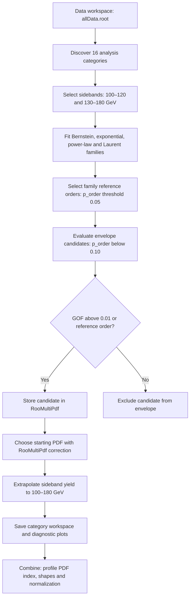

# Background modelling for the ttH/tH CP analysis

This document describes the active analysis in [config_ttH_tH_CP.py](config_ttH_tH_CP.py). General package documentation is in [README.md](README.md).

## Analysis input and configuration

The input data workspace is `Trees2WS/workspaces/Data/allData.root`. The configuration uses an absolute EOS path; update `inputWS` if the input location changes. The observable is `CMS_hgg_mass`, and category datasets follow the convention `Data_13TeV_<category>`.

| Setting | Value | Meaning |
| --- | --- | --- |
| cats | auto | Discover categories from the input workspace |
| catOffset | 0 | Starting category index |
| ext | tth_th_analysis | Output directory suffix |
| year | combined | Combined-year configuration; runner passes year all |
| lumi | 61.9 | Integrated luminosity in fb^-1 |
| sqrts | 13.6 | Collision energy in TeV |
| batch | local | Execute category jobs sequentially |
| queue | microcentury | Relevant for Condor, unused for local execution |

The current input contains 16 categories: `bkg_had`, `bkg_lep`, `tH_had_1–4`, `tH_lep_1–2`, `ttH_had_1–4`, and `ttH_lep_1–4`. Check the category list printed by the runner when using a different input.

## Analysis workflow



The reference-order branch reproduces the inherited selection rule, including its exception to the GOF requirement. Execution diagnostics are reviewed separately from this decision.

## Implementation used

The active [test/fTest.cpp](test/fTest.cpp) follows [Florian's repository](https://github.com/FloMau/flashggFinalFit/tree/higgsdnafinalfit), branch `higgsdnafinalfit`, compared at commit `d9031abb4e8c4e10c312e73912fece53fbd974bb`.

The fitting, goodness-of-fit (GOF), toy generation, order selection, sideband extrapolation and RooMultiPdf construction follow Florian's source. Local changes add `--intLumi` and `--sqrts` options, propagate the configured values into workspace metadata, and support the 13.6 TeV plot label through `tdrStyle/CMS_lumi.h` and `tdrStyle/CMS_lumi.C`.

The analysis uses RooPlot chi-square and Poisson-fluctuated GOF toys.

### Fit range and background yield

The full mass range is 100–180 GeV, with 320 bins of width 0.25 GeV. Background shape fits use the sidebands 100–120 and 130–180 GeV; the central interval 120–130 GeV is excluded. The source reduces the dataset with `CMS_hgg_mass < 120 || CMS_hgg_mass > 130` and fits with the named range `low,high`.

The fitted shape predicts the background in the central interval. Define:

```text
r_SB = integral_sidebands(pdf) / integral_full_range(pdf)
N_background_full = N_observed_SB / r_SB
N_background_blind = N_background_full - N_observed_SB
```

For example, 130 sideband events and a fitted sideband fraction of 0.90 give approximately 144.4 background events over the full range, including 14.4 in the blinded interval. The prediction need not equal the observed full-range count, since the central events were excluded from the shape fit.

The extrapolated full-range yield initializes the floating background normalization. Its lower bound is zero and its upper bound is `max(3 * yield, yield + 10)`. Shape parameters and normalization remain free in the subsequent statistical fit.

### Function selection and discrete profiling

The candidate families are Bernstein polynomials, exponentials, power laws and Laurent series. Supported orders are supplied by PdfModelBuilder.

Within each family, successive orders are compared using:

```text
q = 2 * (NLL_previous - NLL_current)
p_order = TMath::Prob(q, order_current - order_previous)
```

Despite the executable's name, this is a likelihood-ratio comparison with an asymptotic chi-square reference distribution. The reference-order loop uses a threshold of 0.05; the envelope loop uses 0.10.

Envelope admission also normally requires GOF p-value greater than 0.01. Florian's reference-order exception is retained: a reference-order candidate can bypass that GOF threshold. This exception is not a guarantee of a successful or adequate fit; inspect fit diagnostics.

Accepted functions are stored in RooMultiPdf. The function index becomes a discrete nuisance parameter in the final Combine fit. The starting function is selected using the fitted NLL plus the RooMultiPdf correction. The optional order-comparison toy diagnostic does not replace the returned asymptotic p-value.

### Goodness-of-fit prescription

The active code obtains chi-square from RooPlot. When `N_sideband / 320 < 5`, it requests 500 GOF toys:

1. Draw a Poisson-fluctuated total from the observed sideband count.
2. Attempt binned generation with `Range("low,high")`.
3. Refit each toy with the sideband fit range.
4. Calculate the toy RooPlot chi-square.
5. Divide the number of toy statistics at least as large as the observed statistic by 500.

The denominator is the requested toy count, rather than a count of successful fits. The original low-statistics divisor of 320 is retained even though the fit excludes the central interval. Fits use `SumW2Error(true)`, as in Florian's source.

The local ROOT installation rejects the named Range option in generation and data plotting. Consequently, the intended sideband restriction in those calls is not established by the source alone. The supported `fitTo(..., Range("low,high"))` calls still specify sideband fitting. This distinction matters when interpreting GOF toys.

## Build and run

On a CERN machine with access to CVMFS, initialize the CMSSW environment and repository setup:

```bash
source /cvmfs/cms.cern.ch/cmsset_default.sh
cd /eos/home-r/rkumarag/CMSSW_14_1_0_pre4/src
eval "$(scram runtime -sh)"
cd flashggFinalFit
source setup.sh
cd Background
make -j2
```

Use your own CMSSW path if the checkout moves. Rebuild after editing C++ sources or the plotting helper. The current build succeeds with unused-variable warnings.

To display the executable options:

```bash
./bin/fTest --help
```

Florian's source exits with status 1 after printing help; that status alone does not indicate a compilation failure.

To prepare category jobs without executing the fits:

```bash
python3 RunBackgroundScripts.py --inputConfig config_ttH_tH_CP.py --mode fTestParallel --printOnly
```

This creates output directories and replaces generated category job scripts. Run the analysis with:

```bash
bash rkumarag_fTest_v2.sh config_ttH_tH_CP.py
```

Alternatively, run the Python runner directly:

```bash
python3 RunBackgroundScripts.py --inputConfig config_ttH_tH_CP.py --mode fTestParallel
```

With `batch: local`, categories run sequentially despite the `fTestParallel` mode name. Reusing the same extension overwrites the corresponding output files. Use a different extension to preserve a comparison run.

## Outputs and use in Combine

The analysis writes to `Background/outdir_tth_th_analysis/`:

| Output | Purpose |
| --- | --- |
| CMS-HGG_multipdf_<category>.root | Per-category multipdf workspace |
| bkgfTest-Data/ | Candidate, GOF, family-reference and multipdf plots |
| fTestParallel/jobs/ | Generated category shell scripts |

Each ROOT file contains the `multipdf` workspace, the background RooMultiPdf, its discrete index, floating background normalization and data histogram. Conventional object names containing `13TeV` are retained for compatibility; workspace `SqrtS = 13.6` and plot labels specify the actual collision energy.

The inherited code attempts to import full-data and sideband histograms with the same name, and separately imports an index already included with the model. Duplicate-import diagnostics remain. The latest workspace inspection found one stored data object per category; do not assume that distinct full-data and sideband histograms are both saved.

Use the category ROOT files in the background entries of the analysis datacard and declare each pdf index as a discrete nuisance. Confirm object names and the stored observed-data histogram before using them in Combine. This background run does not execute the final signal-plus-background fit.

The wrapper writes timestamped full and cleaned logs, p-value summaries and recommended-order summaries in Background. Preserve these for an analysis audit. The shared `dat/fTest.dat` can be overwritten by successive category jobs and is not a complete per-category record.

## Results from the latest run

The following results correspond to the run started on **9 October 2026 at 20:58:04 local time**. Source records are the [full log](ftest_log_20261009_205804.log), [envelope p-value summary](pvalues_20261009_205804.txt) and [reference-order summary](summary_20261009_205804.txt). The ROOT outputs were inspected after completion.

All 16 categories produced workspaces containing a total of **82 candidate PDFs**. The saved candidate names and order match every envelope-admission entry in the log. The runner reached its completion message without a Python traceback. ROOT diagnostics remain and trigger the logging wrapper's error classification.

### Category summary

The observed count is the full-range total in the saved data histogram. The background yield is the initial full-range normalization obtained from the starting function's sideband extrapolation; it is not a postfit yield. The starting function is subsequently allowed to change through discrete profiling.

| Category | PDFs | Starting function | Observed full-range count | Initial background yield |
| --- | ---: | --- | ---: | ---: |
| bkg_had | 8 | exp3 | 160795 | 160139.31 |
| bkg_lep | 5 | bern3 | 797 | 788.59 |
| tH_had_1 | 4 | bern1 | 32 | 31.40 |
| tH_had_2 | 5 | exp3 | 91 | 93.44 |
| tH_had_3 | 6 | exp3 | 190 | 186.59 |
| tH_had_4 | 7 | bern3 | 366 | 355.64 |
| tH_lep_1 | 5 | pow1 | 10 | 10.52 |
| tH_lep_2 | 5 | pow1 | 32 | 31.66 |
| ttH_had_1 | 4 | bern1 | 28 | 25.36 |
| ttH_had_2 | 5 | bern2 | 83 | 79.53 |
| ttH_had_3 | 5 | bern2 | 227 | 227.42 |
| ttH_had_4 | 6 | pow1 | 313 | 305.47 |
| ttH_lep_1 | 5 | exp1 | 9 | 7.95 |
| ttH_lep_2 | 4 | bern1 | 21 | 20.53 |
| ttH_lep_3 | 4 | pow1 | 18 | 16.39 |
| ttH_lep_4 | 4 | exp1 | 11 | 11.82 |
| **Total** | **82** | — | — | — |

### Envelope functions and p-values

Every function in the following tables is present in the saved envelope. `bernN`, `expN`, `powN` and `lauN` denote the family and implementation order. The complete object name is `env_pdf_<category index>_13TeV_<function>`, where the category index follows the summary table from 0 to 15. **Bold function names** identify the starting PDF reported in the log.

The two probabilities have different meanings:

| Quantity | Interpretation | Selection use |
| --- | --- | --- |
| GOF p-value | Compatibility of the candidate with the observed distribution under the implemented GOF procedure | Normally required to exceed 0.01 |
| Order-comparison p-value | Significance of improvement over the previous tested order in the same family | Required below 0.10 in the envelope loop |

Values are copied at the precision printed in the full log. For the first tested order in a family, the source prints zero for the order-comparison field although no previous candidate exists; those entries are shown as **—** rather than as measured probabilities. For a higher supported order, the comparison is to the previous tested supported order, which need not differ by one.

GOF values from 500 toys have finite ensemble precision. More fundamentally, the rejected generation-range commands described below mean these logged values should not be treated as validated sideband-only toy calibration.

#### bkg_had

| Function | GOF p-value | Order-comparison p-value | Admission note |
| --- | ---: | ---: | --- |
| bern4 | 0.486863 | 9.70955e-37 | Standard GOF admission |
| bern5 | 0.62492 | 0.00188383 | Standard GOF admission |
| **exp3** | 0.660499 | 3.04587e-135 | Standard GOF admission |
| pow1 | 0.390026 | — | Standard GOF admission |
| pow3 | 0 (GOF skipped) | 2.15607e-05 | Reference-order exception; fit status 1 |
| lau1 | 0.477731 | — | Standard GOF admission |
| lau2 | 0.549462 | 0.016533 | Standard GOF admission |
| lau3 | 0.661865 | 0.00140761 | Standard GOF admission |

#### bkg_lep

| Function | GOF p-value | Order-comparison p-value | Admission note |
| --- | ---: | ---: | --- |
| bern1 | 0.096 | — | Standard GOF admission |
| **bern3** | 0.01 | 4.32555e-05 | Reference-order exception; GOF = 0.01 |
| exp1 | 0.062 | — | Standard GOF admission |
| pow1 | 0.104 | — | Standard GOF admission |
| lau1 | 0.042 | — | Standard GOF admission |

#### tH_had_1

| Function | GOF p-value | Order-comparison p-value | Admission note |
| --- | ---: | ---: | --- |
| **bern1** | 0.174 | — | Standard GOF admission |
| exp1 | 0.38 | — | Standard GOF admission |
| pow1 | 0.304 | — | Standard GOF admission |
| lau1 | 0.39 | — | Standard GOF admission |

#### tH_had_2

| Function | GOF p-value | Order-comparison p-value | Admission note |
| --- | ---: | ---: | --- |
| bern1 | 0.18 | — | Standard GOF admission |
| exp1 | 0.23 | — | Standard GOF admission |
| **exp3** | 0.422 | 0.0445293 | Standard GOF admission |
| pow1 | 0.262 | — | Standard GOF admission |
| lau1 | 0.31 | — | Standard GOF admission |

#### tH_had_3

| Function | GOF p-value | Order-comparison p-value | Admission note |
| --- | ---: | ---: | --- |
| bern1 | 0.112 | — | Standard GOF admission |
| bern2 | 0.114 | 0.00776769 | Standard GOF admission |
| exp1 | 0.17 | — | Standard GOF admission |
| **exp3** | 0.392 | 0.0161607 | Standard GOF admission |
| pow1 | 0.178 | — | Standard GOF admission |
| lau1 | 0.222 | — | Standard GOF admission |

#### tH_had_4

| Function | GOF p-value | Order-comparison p-value | Admission note |
| --- | ---: | ---: | --- |
| bern1 | 0.404 | — | Standard GOF admission |
| bern2 | 0.2 | 1.66877e-07 | Standard GOF admission |
| **bern3** | 0.262 | 0.0484211 | Standard GOF admission |
| exp1 | 0.386 | — | Standard GOF admission |
| exp3 | 0.564 | 0.0397766 | Standard GOF admission |
| pow1 | 0.508 | — | Standard GOF admission |
| lau1 | 0.628 | — | Standard GOF admission |

#### tH_lep_1

| Function | GOF p-value | Order-comparison p-value | Admission note |
| --- | ---: | ---: | --- |
| bern1 | 0.126 | — | Standard GOF admission |
| bern2 | 0.892 | 0.0817592 | Standard GOF admission |
| exp1 | 0.234 | — | Standard GOF admission |
| **pow1** | 0.218 | — | Standard GOF admission |
| lau1 | 0.266 | — | Standard GOF admission |

#### tH_lep_2

| Function | GOF p-value | Order-comparison p-value | Admission note |
| --- | ---: | ---: | --- |
| bern1 | 0.116 | — | Standard GOF admission |
| bern2 | 0.292 | 0.0954601 | Standard GOF admission |
| exp1 | 0.298 | — | Standard GOF admission |
| **pow1** | 0.3 | — | Standard GOF admission |
| lau1 | 0.272 | — | Standard GOF admission |

#### ttH_had_1

| Function | GOF p-value | Order-comparison p-value | Admission note |
| --- | ---: | ---: | --- |
| **bern1** | 0.216 | — | Standard GOF admission |
| exp1 | 0.27 | — | Standard GOF admission |
| pow1 | 0.274 | — | Standard GOF admission |
| lau1 | 0.304 | — | Standard GOF admission |

#### ttH_had_2

| Function | GOF p-value | Order-comparison p-value | Admission note |
| --- | ---: | ---: | --- |
| bern1 | 0.592 | — | Standard GOF admission |
| **bern2** | 0.526 | 0.000751354 | Standard GOF admission |
| exp1 | 0.742 | — | Standard GOF admission |
| pow1 | 0.762 | — | Standard GOF admission |
| lau1 | 0.706 | — | Standard GOF admission |

#### ttH_had_3

| Function | GOF p-value | Order-comparison p-value | Admission note |
| --- | ---: | ---: | --- |
| bern1 | 0.034 | — | Standard GOF admission |
| **bern2** | 0.028 | 4.87699e-05 | Standard GOF admission |
| exp1 | 0.078 | — | Standard GOF admission |
| pow1 | 0.118 | — | Standard GOF admission |
| lau1 | 0.148 | — | Standard GOF admission |

#### ttH_had_4

| Function | GOF p-value | Order-comparison p-value | Admission note |
| --- | ---: | ---: | --- |
| bern1 | 0.382 | — | Standard GOF admission |
| bern2 | 0.25 | 0.000318808 | Standard GOF admission |
| exp1 | 0.356 | — | Standard GOF admission |
| **pow1** | 0.414 | — | Standard GOF admission |
| lau1 | 0.368 | — | Standard GOF admission |
| lau2 | 0.578 | 0.0121738 | Standard GOF admission |

#### ttH_lep_1

| Function | GOF p-value | Order-comparison p-value | Admission note |
| --- | ---: | ---: | --- |
| bern1 | 0.85 | — | Standard GOF admission |
| bern2 | 0.448 | 0.0681435 | Standard GOF admission |
| **exp1** | 0.71 | — | Standard GOF admission |
| pow1 | 0.728 | — | Standard GOF admission |
| lau1 | 0.792 | — | Standard GOF admission |

#### ttH_lep_2

| Function | GOF p-value | Order-comparison p-value | Admission note |
| --- | ---: | ---: | --- |
| **bern1** | 0.738 | — | Standard GOF admission |
| exp1 | 0.718 | — | Standard GOF admission |
| pow1 | 0.698 | — | Standard GOF admission |
| lau1 | 0.806 | — | Standard GOF admission |

#### ttH_lep_3

| Function | GOF p-value | Order-comparison p-value | Admission note |
| --- | ---: | ---: | --- |
| bern1 | 0.626 | — | Standard GOF admission |
| exp1 | 0.7 | — | Standard GOF admission |
| **pow1** | 0.66 | — | Standard GOF admission |
| lau1 | 0.874 | — | Standard GOF admission |

#### ttH_lep_4

| Function | GOF p-value | Order-comparison p-value | Admission note |
| --- | ---: | ---: | --- |
| bern1 | 0.492 | — | Standard GOF admission |
| **exp1** | 0.532 | — | Standard GOF admission |
| pow1 | 0.58 | — | Standard GOF admission |
| lau1 | 0.654 | — | Standard GOF admission |

The `bkg_had/pow3` candidate was admitted despite fit status 1: its GOF calculation was skipped and the stored log value of zero is a placeholder, not a measured GOF p-value. The `bkg_lep/bern3` candidate has GOF exactly 0.01, which does not pass the strict `> 0.01` requirement; it was retained as the family reference order. Both outcomes follow Florian's inherited exception.

### Workspace checks

| Check | Result |
| --- | --- |
| Readable ROOT files with multipdf workspace | 16 of 16 |
| Saved envelope membership agrees with log | 82 of 82 functions |
| Stored luminosity | IntLumi = 61900 pb^-1 in every workspace |
| Stored collision energy | SqrtS = 13.6 TeV in every workspace |
| Finite, positive initial background normalization | 16 of 16 |
| Finite, nonnegative candidate density at 125 GeV | 82 of 82 |
| Stored observed-data objects | One full-data histogram per category |
| Correct luminosity/energy labels printed in log | 32 instances of 61.9 fb^-1 (13.6 TeV) |

The point evaluation checks stored parameter values at 125 GeV. It does not establish positivity over the full mass range or convergence during toy refits.

### Runtime diagnostics and interpretation

| Diagnostic in the full log | Count | Meaning |
| --- | ---: | --- |
| Rejected RangeWithName commands | 254,577 | Named range options rejected in generation/data plotting |
| Non-finite PDF evaluation messages | 226 | Numerical evaluation failures during fitting |
| Skipped GOF messages | 17 | Candidate GOF skipped after failed fit or non-finite parameters |
| Duplicate observed-data imports | 16 | Sideband histogram import rejected after full-data histogram import |
| Duplicate discrete-index imports | 16 | Index already imported with the model |

The generation diagnostics mean the intended restriction to sidebands was not applied through the named Range option. Plotting diagnostics may have less impact when the observed dataset was already reduced to sidebands, but that does not establish equivalence for generated toys. The sideband range in `fitTo` is a supported call and remains part of the shape-fit procedure.

The output histograms were checked directly: each workspace contains one `roohist_data_mass_<category>` object with the full-data count. The attempted second histogram import does not create an additional sideband data object. The index remains present through the model import despite the redundant explicit import diagnostic.

These outputs document completion of the configured background workflow and the exact retained functions. Assessment for final inference also requires review of fit convergence, toy GOF calibration, central-region extrapolation and background-bias or spurious-signal studies. Successful workspace checks alone do not establish those properties.
